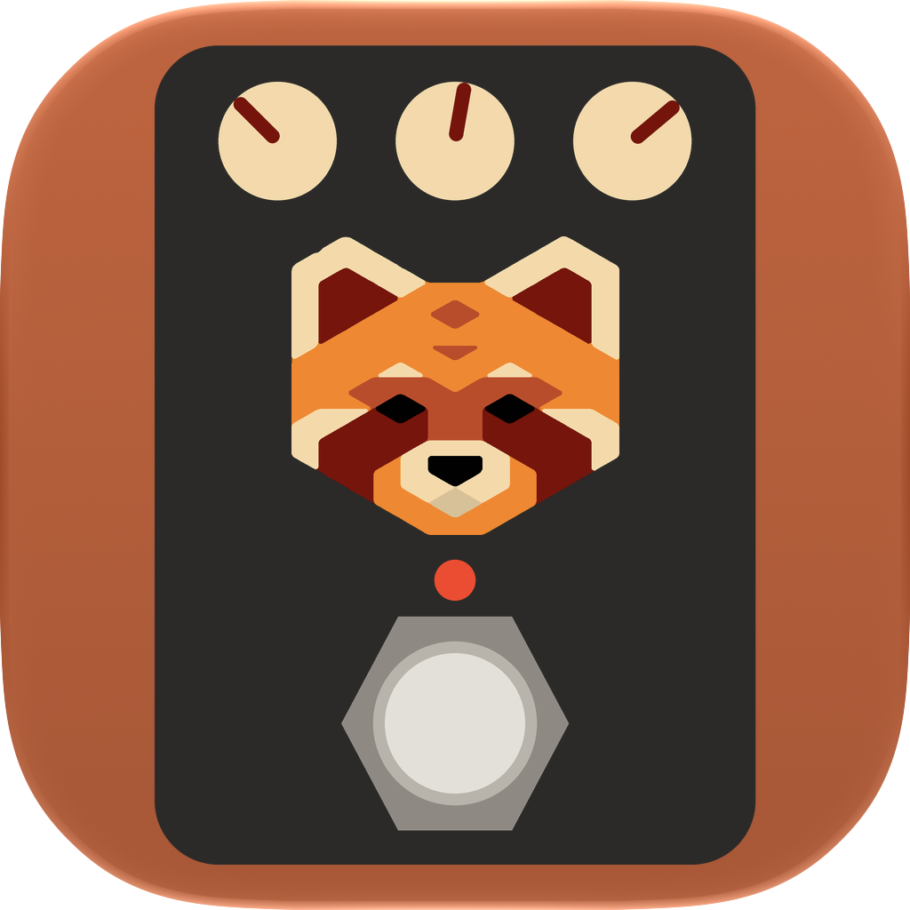

# Ailurus Tone Editor

Open editor for the BOSS GX-10 and the BOSS KATANA Gen 3 amps — an alternative to BOSS TONE
STUDIO, with its own app window
and an MCP server, so an AI (Claude, Codex, Gemini, LM Studio, ...) can tune your sound live
while you play. **Draft 1** - works on macOS from source; packaged app, Windows and Linux later.

Not affiliated with, endorsed by or sponsored by Roland Corporation or BOSS. BOSS, GX-10, KATANA
and BOSS TONE STUDIO are trademarks of Roland Corporation, named here only to say what the app
works with.

Roland's parameter tables are **not** part of this project: they are read at runtime from
your installed BOSS TONE STUDIO for GX-10 / for KATANA Gen 3 (the one for your unit must be
installed, but must not be running).

## Run (from source)

    python3.13 -m venv .venv
    .venv/bin/pip install -e ".[dev]"
    .venv/bin/python -m ailurus_tone                 # app window
    .venv/bin/python -m ailurus_tone --server        # no window, UI at http://127.0.0.1:8710/
    .venv/bin/python -m ailurus_tone --demo FILE     # no GX-10: one patch from a backup JSON, nothing sent

Plug the GX-10 straight into the computer (USB MIDI does not work through a hub) and quit
BOSS TONE STUDIO. The app connects by itself. The KATANA Gen 3 needs Roland's *KATANA3
Driver* (the older KATANA driver gives no MIDI port).

With several units plugged in, the switcher at the top of the window picks the one you
edit; MCP tools take an optional `device` argument, and `gx_select_device` changes the
active one.

## Build the macOS app

    .venv/bin/pip install -e ".[dev]"
    packaging/build_macos.sh

Gives `dist/Ailurus Tone Editor.app` and `dist/Ailurus-Tone-Editor-<version>.dmg` (PyInstaller,
Apple Silicon, macOS 13+). The app is ad-hoc signed, not notarized: after downloading it,
macOS refuses the first start - open System Settings → Privacy & Security → "Open Anyway".
BOSS TONE STUDIO for your unit must still be installed (its tables are read at runtime).

## Updates

The app checks for a new version once a day and on demand (*Ailurus Tone Editor → Check
for Updates…*), using [Sparkle](https://sparkle-project.org). The feed is `appcast.xml` on
the latest GitHub release; every update is verified with an EdDSA signature before it is
installed, and an update installed this way does not trigger "Open Anyway" again.
Releases are built by `.github/workflows/release.yml` when a `v*` tag is pushed.

## MCP

Streamable HTTP at `http://127.0.0.1:8710/mcp` while the app runs. Tools: `gx_status`,
`gx_list_patches`, `gx_read_patch`, `gx_set`, `gx_switch`, `gx_undo`, `gx_redo`,
`gx_select_patch`, `gx_select_device`, `gx_backup_all`, `gx_set_chain` (reorder a straight chain), `gx_history`
(what the player, the unit and the AI changed, including undo; kept in `<config>/history/*.jsonl`).

Claude Code: `claude mcp add --transport http ailurus-tone http://127.0.0.1:8710/mcp`

## What draft 1 does and does not do

- Live edits change the **current sound** (the unit's temp patch) only. No user slot is
  ever written; switching patch discards the edits.
- Undo/Redo (Cmd/Ctrl+Z), one knob drag = one step; a history of every change by you, the AI
  or a knob on the unit, which the AI can read.
- Drag effects to reorder a straight chain.
- Bulk backup of all 198 user patches (U01-1..U66-3) to the default folder or a chosen one.
- KATANA Gen 3: live edits of every block (edit buffer only, memories are never written),
  patch switching (PANEL, A:CH1..B:CH4), signal order shown as on the amp, backup of all
  9 memories. The chain is set with the CHAIN parameter, not by dragging.
- Not yet: Save / Save as / Restore, `.tsl` import/export, Compare, Windows/Linux packaging,
  notarized build, MCP bearer token, divider/splitter branch layout.

## Layout

    ailurus_tone/bts.py         load tables from the installed BOSS TONE STUDIO (embedded V8)
    ailurus_tone/roland.py      generic Roland SysEx RQ1/DT1 transport (device independent)
    ailurus_tone/device.py      GX-10 profile: addresses, patch layout, decode, live edits, undo
    ailurus_tone/katana_bts.py  KATANA Gen 3 tables from its installed BOSS TONE STUDIO
    ailurus_tone/katana.py      KATANA Gen 3 profile: edit buffer, variations, chain, patches
    ailurus_tone/backup.py      bulk backup + app config
    ailurus_tone/state.py       one owner of all units; active unit, connect/disconnect watcher
    ailurus_tone/mcp_tools.py   MCP tools
    ailurus_tone/api.py         REST for the window
    ailurus_tone/__main__.py    entry point, app window (pywebview)
    ailurus_tone/web/           UI (HTML/CSS/JS)
    ailurus_tone/help/          short hover help texts (en, cs) - our own words
    ailurus_tone/history.py     activity log (what changed, by whom), read by the AI
    tools/make_icon.py          builds the app icon (Icon Composer layers, icns, ico)
    ailurus_tone/updater.py     Sparkle automatic updates (packaged macOS app only)
    packaging/                  PyInstaller spec + build_macos.sh (.app and .dmg, bundles Sparkle)
    .github/workflows/          release build: DMG + signed appcast.xml on a v* tag
    tests/                      unit tests, no unit needed

## Licence

© 2026 David Urban. [PolyForm Noncommercial 1.0.0](LICENSE): free to use, study and change
for personal, hobby, educational and other non-commercial purposes. **Commercial use —
by or for a company, or reselling it — needs my written permission**; ask in
[Issues](https://github.com/TursiThePanda/ailurus-tone-editor/issues).
The red panda artwork is mine and is covered by the same licence.
